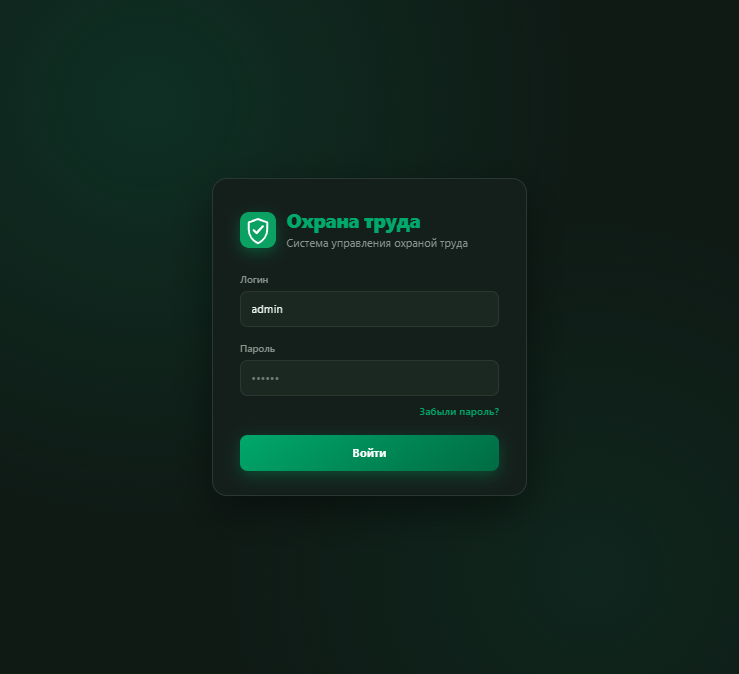
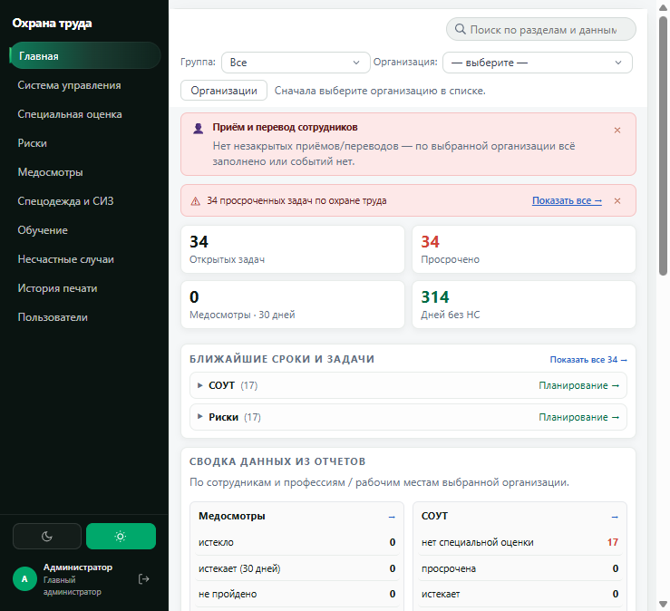
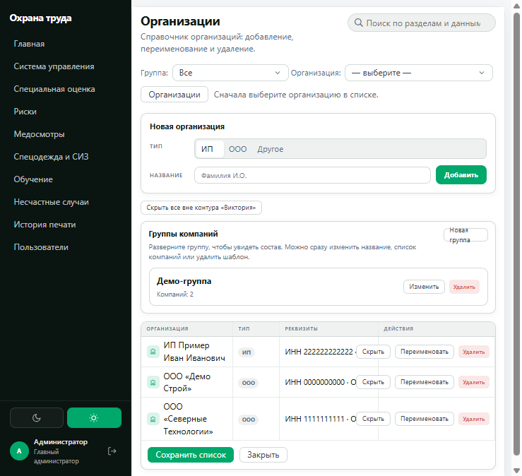
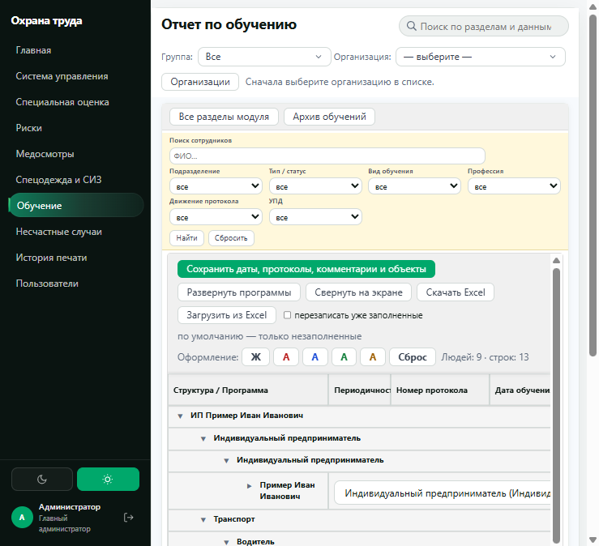
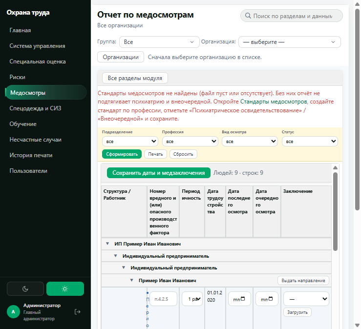
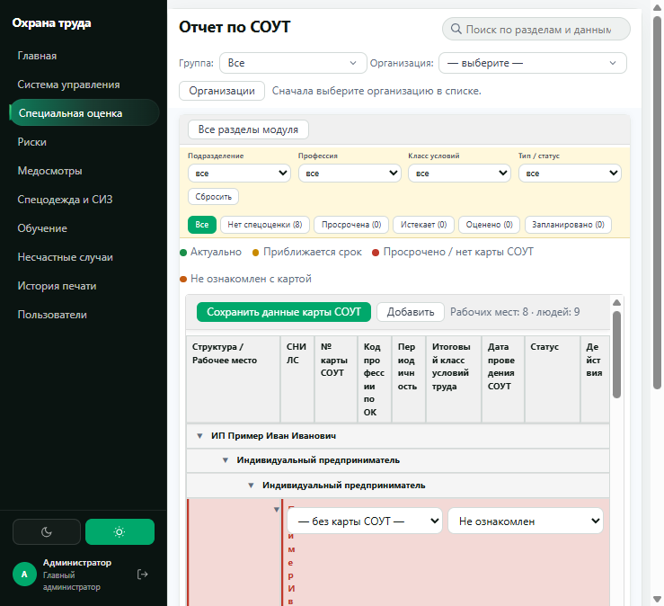
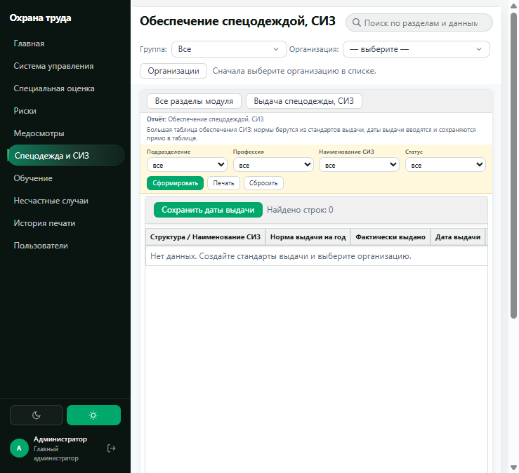
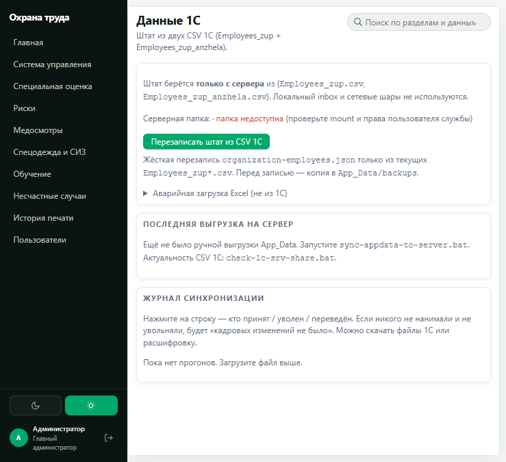

<p align="center">
  
</p>

<h1 align="center">Веб-система «Охрана труда»</h1>

<p align="center">
  
  
  
  
  
</p>

---

Комплексная веб-система для автоматизации процессов управления охраной труда на предприятии. Объединяет основные направления работы в едином интерфейсе: управление организационной структурой и персоналом, обучение сотрудников, медицинские осмотры, обеспечение средствами индивидуальной защиты, специальную оценку условий труда (СОУТ) и контроль электробезопасности.

Репозиторий содержит демонстрационную версию приложения с тестовыми данными. Реальные персональные данные, учётные записи, пароли и скрипты развёртывания в репозиторий не включены.

## Основные возможности

- **Организационная структура и персонал** — ведение организаций, подразделений, должностей и учёт сотрудников.
- **Интеграция с 1С** — импорт кадровых данных из CSV-файлов, включая приём, увольнение и перевод сотрудников.
- **Обучение и инструктажи** — управление программами обучения, отслеживание статусов, обработка заявок и ведение журналов инструктажей.
- **Медицинские осмотры** — формирование контингента, подготовка направлений, планирование графиков и учёт медицинских заключений.
- **Средства индивидуальной защиты (СИЗ)** — ведение номенклатуры, норм обеспечения, личных карточек учёта и регистрации выдачи СИЗ.
- **СОУТ и профессиональные риски** — учёт рабочих мест, ведение карт, хранение и обработка сопутствующей документации.
- **Электробезопасность** — организация проверки знаний, ведение сведений о комиссиях и результатах аттестации.
- **Формирование документов** — автоматизированная печать и подготовка документов на основе шаблонов Word и Excel.

## Скриншоты

| Вход | Главная |
|:----:|:-------:|
|  |  |

| Организации | Обучение |
|:-----------:|:--------:|
|  |  |

| Медосмотры | СОУТ |
|:----------:|:----:|
|  |  |

| СИЗ | Интеграция с 1С |
|:---:|:---------------:|
|  |  |

На экране «Данные 1С» можно подключить выгрузку штата из CSV или загрузить Excel вручную. В этой демо-сборке автосинк выключен (`OneC:Enabled=false`), чтобы не ходить на боевой сервер.

## Технологический стек

<p>
  
  
  
  
  
</p>

- **Платформа:** .NET 10
- **Backend:** ASP.NET Core
- **Архитектура интерфейса:** Razor Pages
- **Хранение данных:** JSON-файлы в каталоге `App_Data`

## Запуск проекта

Для запуска необходим установленный [.NET SDK 10](https://dotnet.microsoft.com/download).

1. Открыть корневую директорию проекта.
2. Выполнить команду:

```powershell
.\start-web.bat
```

3. Браузер откроется сам на [http://localhost:5298](http://localhost:5298) (окно запуска не закрывайте).

**Демонстрационные учётные данные:**

- Логин: `admin`
- Пароль: `123`

Решение проекта: `Zashita.slnx`.

## Структура проекта

```text
Web/
├── Zashita.Web/
│   ├── Pages/       — страницы веб-приложения
│   └── App_Data/    — данные приложения
│
└── Zashita.Core/    — бизнес-логика и основные модули
                     (персонал, обучение, медосмотры,
                      СИЗ, СОУТ и другие направления)
```

## Демонстрационные данные

Для ознакомления с функциональностью в системе предусмотрены тестовые организации:

- ООО «Демо Строй»
- ООО «Северные технологии»
- ИП «Пример Иван Иванович»

Также добавлены демонстрационные сведения о сотрудниках и другие тестовые записи, позволяющие проверить работу основных модулей системы.
